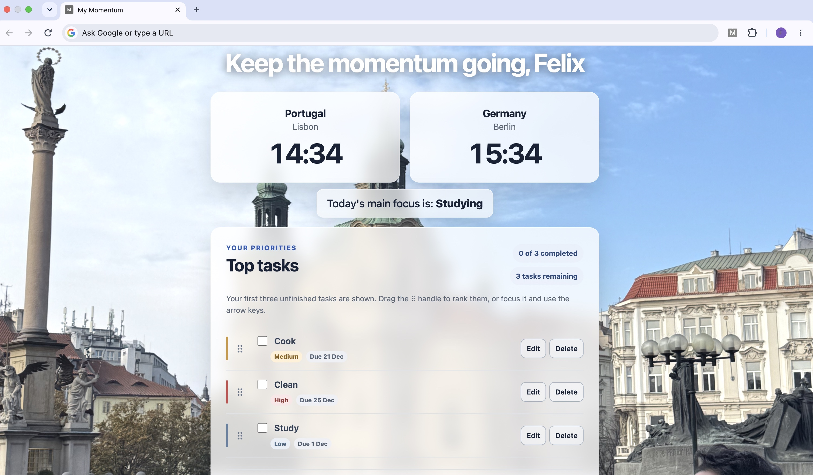

# My Momentum

My Momentum is a private Chrome new-tab extension that combines a daily focus,
ranked tasks, configurable world clocks, and personal photo backgrounds in one
dashboard. It is built with plain HTML, CSS, and JavaScript and runs entirely in
the browser.

## Screenshot



The screenshot shows the extension in active use with a personal background,
configured clocks, a saved daily focus, and ranked tasks with priorities and due
dates.

## Purpose

The project replaces Chrome's default new-tab page with a focused personal
dashboard. Its purpose is to make the information and actions I use throughout
the day immediately available whenever I open a new tab.

The extension provides:

- A personalized, time-aware greeting.
- Two independently configurable world clocks.
- One visible main focus for the current day.
- Ranked tasks with priorities, due dates, progress, and completion tracking.
- A local library of personal background photos.
- Responsive, translucent controls designed to keep background photos visible.

## Data collection

The extension does not collect data from an external service and does not make
network requests. All data originates from direct user interaction or browser
APIs:

- **Tasks:** entered and edited through the task form.
- **Daily focus:** entered through the Daily Focus form.
- **Personalization:** name, greeting style, timezones, and photo darkness selected
  in the Personalize Dashboard panel.
- **Photos:** image files explicitly selected by the user through the file picker.
- **Time and date:** obtained from the browser's `Date` and `Intl.DateTimeFormat`
  APIs. No online time API is used.

Uploaded images are checked for supported type, file size, and browser readability
before they are saved. The extension does not transmit tasks, settings, focus text,
or photos to another person or service.

## Data persistence

Data is stored locally in the current Chrome profile so that the dashboard remains
useful after a reload or browser restart.

| Data | Storage location | Reason |
| --- | --- | --- |
| Tasks, ranking, priorities, due dates, and completion state | `localStorage`, key `my-momentum-tasks` | Restore the task list and calculate progress. |
| Current daily focus and its date | `localStorage`, key `my-momentum-daily-focus` | Show the focus only on the day for which it was saved. |
| Name, greeting style, timezones, and photo darkness | `localStorage`, key `my-momentum-settings` | Preserve dashboard personalization. |
| Uploaded photo files and filenames | IndexedDB, database `my-momentum-photos` | Store image files locally without converting them to large text values. |

Task, focus, and settings changes synchronize between dashboard tabs in the same
Chrome profile through the browser's `storage` event. Data is not synchronized
between devices or different Chrome profiles. Clearing the extension's browser
data or removing the extension can remove locally stored data.

## User interaction

### Daily dashboard

1. Open a new Chrome tab to see the greeting, clocks, daily focus, and top tasks.
2. Use **Personalize dashboard** to change the name, greeting style, greeting
   timezone, both clock locations, or background darkness.
3. Edit or clear the daily focus using the controls at the bottom of the page.

### Tasks

1. Enter a task below the existing task list.
2. Optionally select High, Medium, or Low priority and a due date.
3. Use the checkbox to complete or reopen the task.
4. Use **Edit** to update its text, priority, or due date.
5. Drag the **⠿** handle to change its rank. With the handle focused, the up and
   down arrow keys provide the same functionality.
6. Expand the list to see tasks beyond the first three unfinished items and any
   completed tasks.

### Background photos

1. Open **Background photos**.
2. Select JPEG, PNG, or WebP files of up to 10 MB each.
3. Preview or remove stored photos from the library.
4. Open a new tab to randomly select one of the saved photos as the background.

The library holds a maximum of 10 photos. The same image can be selected on
consecutive tabs because the choice is random.

## Setup

### Requirements and dependencies

- Google Chrome or another Chromium browser that supports Manifest V3 new-tab
  overrides.
- No account, server, package manager, external library, or build tool is required.
- No API keys or environment variables are required.

### Installation

1. Clone or download this repository.
2. Open `chrome://extensions` in Chrome.
3. Enable **Developer mode**.
4. Select **Load unpacked**.
5. Choose the repository's `my-momentum` folder, which contains `manifest.json`.
6. Open a new tab and accept Chrome's new-tab replacement prompt if it appears.

The extension is now running. Configuration is performed inside the dashboard;
there is no separate configuration file.

### Running after code changes

1. Save the changed project files.
2. Return to `chrome://extensions`.
3. Press the reload button on the My Momentum extension card.
4. Open a fresh tab.

## Project structure

```text
my-momentum/
├── manifest.json
├── newtab.html
├── README.md
├── PM.md
├── AUDIT.md
├── docs/
│   └── my-momentum-dashboard.jpeg
└── src/
    ├── features/
    │   ├── backgrounds.js
    │   ├── clocks.js
    │   ├── focus.js
    │   ├── settings.js
    │   └── tasks.js
    └── styles/
        └── newtab.css
```

- `manifest.json` registers the Manifest V3 new-tab override.
- `newtab.html` defines the dashboard structure and loads its assets.
- `src/features/` separates the JavaScript by user-facing feature.
- `src/styles/newtab.css` contains the responsive design and animations.
- `PM.md` records the current product requirements and acceptance criteria.
- `AUDIT.md` records the sanitized public-repository review and remaining limitations.

## Learning

This was the first application I built during the course that worked successfully. The job-hunt search project initially felt overwhelming, so building a smaller and more personal dashboard was a useful first step. It gave me a manageable way to understand how an application develops from an idea into something I can use.

My first learning was understanding the environment in which the program runs. The extension is a self-contained program inside the browser. Almost all of its data is entered by the user, with the main exception being time and date information provided by browser APIs. This helped me understand the difference between an application that manages local user data and one that depends on external data sources or a backend.

One of the main challenges I encountered was turning my broad idea for a personal dashboard into a clear and manageable set of features. At first, I knew what I wanted the extension to achieve, but I found it difficult to define exactly what it should include and how each feature should behave. To address this, I brainstormed the dashboard's purpose and possible functions with ChatGPT. I then created `PM.md`, where I documented each desired feature, its purpose, and its expected behavior. This helped me organize my ideas, decide which features were most important, and create a structured plan before using ChatGPT to translate the requirements into code.

A particularly valuable part of the process to help me understand was being able to check every code change directly in the browser. I could reload the extension, open a new tab, and immediately see what had changed. This fast feedback loop helped me learn how to write clearer prompts: I became better at describing the result I wanted, reviewing what the code produced, and explaining what needed to be adjusted.

I also became more comfortable as each new addition started working. I began with simple features such as the clocks and welcome message, and then gradually added more complex functionality, including the daily focus, task priorities, due dates, drag-and-drop ranking, configurable backgrounds, and personalization settings. This showed me that a larger application can be built incrementally from small working parts.

This was also the first project I uploaded to GitHub. I learned how a repository is structured, how commits record progress, and how local and remote versions are kept synchronized. This experience gave me a foundation for using GitHub in future projects.

Finally, I learned why code organization matters. As the application became larger, I separated the code into clear feature files and grouped them in a `features` folder. This makes the repository easier for another person to understand and makes it faster to find the code responsible for tasks, focus, clocks, settings, or backgrounds.

## Limitations and assistance

### Current limitations

- Data remains in one Chrome profile and is not synchronized across devices.
- There is no export, import, or cloud-backup feature.
- Removing the extension or clearing its browser data can remove saved content.
- The background library is limited to 10 images of up to 10 MB each.
- Clock selection is limited to the timezones currently listed in the settings.
- Deleting a task or photo has no undo action.
- The project currently relies on manual acceptance checks rather than an automated browser test suite.

### External code and assistance

The project does not include third-party libraries, copied tutorial code, or
external runtime dependencies. It uses standard browser APIs and original project code.

OpenAI ChatGPT/Codex was used as an AI-assisted development tool for brainstorming,code review, implementation support, debugging, refactoring, documentation, and syntax verification. The generated suggestions were reviewed and adapted to the project's requirements. Git and GitHub were used for version control and remote repository hosting.

## Manual acceptance checks

- Change the name, greeting style, all three timezone settings, and photo darkness;
  reload and confirm that each setting persists.
- Add, edit, complete, reopen, rank, expand, and delete tasks.
- Test every priority and tasks with and without due dates.
- Confirm that progress, overdue styling, and the daily summary update correctly.
- Save and clear the daily focus and verify its behavior in a second dashboard tab.
- Upload valid photos and reject unsupported, unreadable, or oversized files.
- Remove all photos and confirm that the dark default background remains readable.
- Check pointer and keyboard task reordering.
- Check the layout at narrow mobile widths and with reduced motion enabled.
